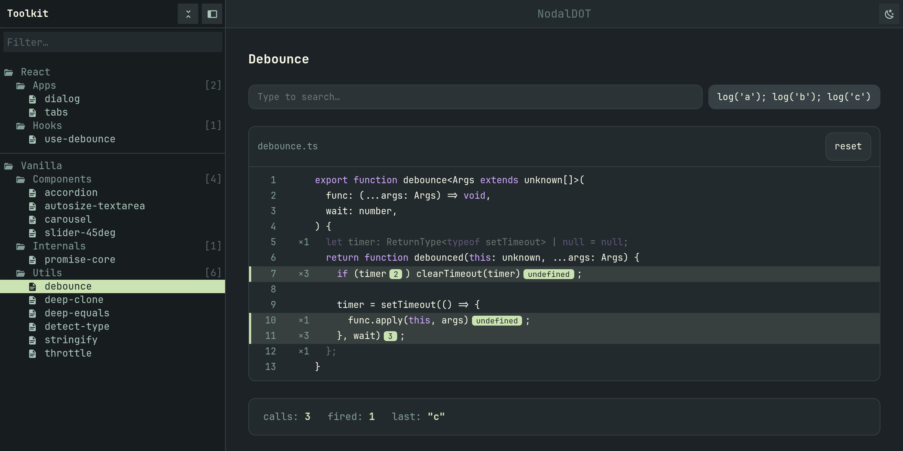

# Toolkit – a showcase for web snippets

[](https://nodaldot.github.io/toolkit/)
[](https://github.com/NodalDOT/toolkit/actions/workflows/pages.yml)
[](./LICENSE)

A place to collect small HTML, CSS, JavaScript and React examples and browse them in one interface. Drop a folder into `snippets/` and it shows up in the sidebar.

## Preview

[](https://nodaldot.github.io/toolkit/)

Try it live: [nodaldot.github.io/toolkit](https://nodaldot.github.io/toolkit/)

## Toolkit?

Most snippet collections end up as a folder of loose files that are hard to open and compare. Toolkit turns that folder into a static site: a sidebar with sections and categories, a live preview of every snippet, a light and a dark theme, and a code view that shows values while the code runs.

Everything is built with Vite into plain HTML, so the result can be hosted anywhere, including GitHub Pages.

## Features

- **Route indexer** – builds the sidebar from the folder structure and `meta.json` files.
- **HTML directives** – a small template engine for HTML: partials, loops, inline icons and inline scripts.
- **Code trace** – a `<code-trace>` element that shows a source file with the values of its expressions as they run.

## Installation

Requires Node.js `^22.18.0 || >=24` and pnpm 12.

```sh
git clone https://github.com/NodalDOT/toolkit.git
cd toolkit
corepack enable
pnpm install
cp .env.example .env
pnpm dev
```

## Usage

### Adding a snippet

Snippets live in three levels: section, category, snippet.

```
snippets/
└── vanilla/                  section
    ├── meta.json
    └── components/           category
        ├── meta.json
        └── dialog/           snippet
            ├── meta.json
            ├── index.html
            └── style.css
```

Every folder needs a `meta.json` with a title:

```json
{ "title": "dialog" }
```

Items are sorted by title. A snippet appears only when it has an `index.html`, and empty categories are hidden.

To match the showcase look, include the shared head and theme script:

```html
<!doctype html>
<html lang="en">
  <head>
    <template data-html-content="snippet-head"></template>
    <title>Dialog</title>
  </head>
  <body data-theme="%DEFAULT_THEME%">
    <template data-html-script="snippet-theme"></template>
    <main class="snippet">
      <h1 class="snippet-title">Dialog</h1>
    </main>
  </body>
</html>
```

### HTML directives

Directives are `<template>` elements that are replaced at build time.

| Directive                  | Replaced with                                          |
| -------------------------- | ------------------------------------------------------ |
| `data-html-content="name"` | `showcase/ui/partials/name.html`                       |
| `data-html-icon="name"`    | `showcase/ui/icons/name.svg`                           |
| `data-html-script="name"`  | `showcase/ui/scripts/name.js` as an inline `<script>`  |
| `data-html-each="key"`     | the template content, repeated for every item in `key` |

In the page HTML and in inline scripts, `{{ name }}` is replaced with a value from the page data. Inside `data-html-each`, the fields of the current item are available too.

### Code trace

Point `<code-trace>` at a file next to the page. Its code is instrumented, and every expression shows its latest value inline.

```html
<code-trace src="debounce.ts"></code-trace>
```

Call `startRun()` before each run so the view highlights only the lines that ran this time:

```ts
import { startRun } from "@toolkit/code-trace/runtime";
import { debounce } from "./debounce";

input.addEventListener("input", () => {
  startRun();
  log(input.value);
});
```

The **reset** button in the header clears all values and hit counters.

## Configuration

Settings are read from `.env`. Variables set in the environment take priority. Every key from `.env.example` is required.

| Variable      | Description                            |
| ------------- | -------------------------------------- |
| `PORT`        | Port for `pnpm dev` and `pnpm preview` |
| `GITHUB_URL`  | Link shown in the header               |
| `GITHUB_NAME` | Text of that link                      |

## Local Development

Below is a list of commands you will probably find useful.

### `pnpm dev`

Starts the Vite dev server. Changes to snippets and `meta.json` files reload the page.

### `pnpm build`

Type-checks the project and builds the static site into `dist/`.

### `pnpm preview`

Serves `dist/` with Vite.

### `pnpm test`

Runs the tests of all packages.

### `pnpm typecheck`

Type-checks the app and all packages.

### `pnpm lint` and `pnpm format`

Fix code with ESLint and Stylelint, and format it with Prettier.

## Project Structure

```
packages/
├── code-trace/        <code-trace> element, runtime and Vite plugin
├── html-directives/   HTML template engine and Vite plugin
└── route-indexer/     reads the snippets tree and meta.json files
showcase/
├── build/             Vite plugins, inputs and catalog
├── config/            env, paths and app settings
└── ui/                styles, scripts, icons and partials of the showcase
snippets/              the snippets themselves
index.html             showcase entry page
```

## Tech Stack

- [Vite](https://vite.dev) and TypeScript
- React for React snippets
- [Zod](https://zod.dev) for `meta.json` validation
- ESLint, Stylelint and Prettier

## Deployment

Every push to `main` builds the site and deploys it to GitHub Pages through `.github/workflows/pages.yml`.

## FAQ

### My snippet doesn’t appear in the sidebar

Check that the section, the category and the snippet folder each have a `meta.json` and that the snippet folder has an `index.html`.

### The build fails with “Missing env variables”

Copy `.env.example` to `.env` and fill in every value, or set the variables in the environment.

## License

[MIT](./LICENSE) – use, copy and change the code however you like.
